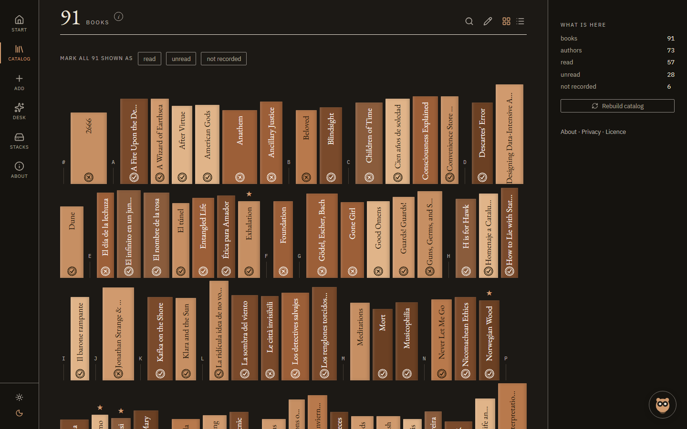
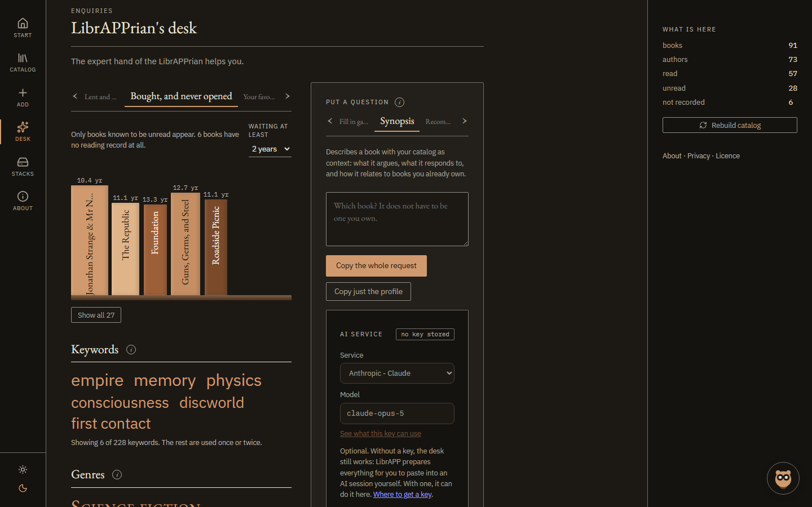
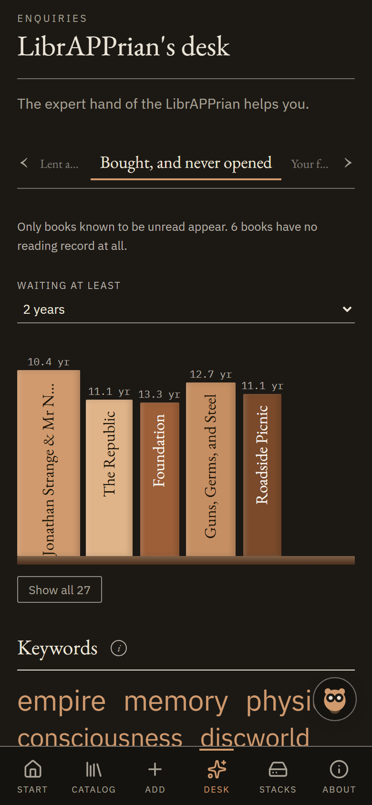

# LibrAPP

[](https://github.com/JesusJBallesteros/LibrAPP/actions/workflows/tests.yml)
[](https://github.com/JesusJBallesteros/LibrAPP/actions/workflows/pages.yml)
[](LICENSE.md)

### Your own e-library at hand.

Put your books and e-books finally together, have a tiny librarian take care of it.

[](https://jesusjballesteros.github.io/LibrAPP/#demo)

## → [**Check the demo library**](https://jesusjballesteros.github.io/LibrAPP/#demo) ←

At the demo you can browse the catalog, edit read/unread and book info, and then...
ask something to the LibrAPPrian.

No installation or registration needed. Nothing is saved to your device until you create your own library.

---

Then **add your own books:**

**Take a picture.** LibrAPP can use a photograph to read the spines and convert it into
a catalog you can filter and browse. Or you can start with your own spreadsheet or read
barcodes one by one. 

**Ask your LibrAPPrian.** The [LibrAPPrian's desk](docs/the-desk.md) knows your 
catalog: it will suggest what to read next and why, which author's books you have
are missing, what threads run through your library, prepare a list for your next holiday.
The answers are based on **your** books.

**Know the situation.** Which books are yet to read? What did you lend, and to whom? 
What are the main topics? From whom did you borrow that book?



**Your info stays on your device.** No account, no server, no sync. It works
offline. Three optional features will need internet connection: [below](#about-privacy-and-version)

---

## What it does

| | |
|---|---|
| **Import** | shelf photographs, spreadsheets, CSV, barcodes |
| **Browse** | search, filter and group offline |
| **Ask** | recommendations, synopses and reading lists, with your own catalog as context;
analyze your library, which book are you missing? |
| **Mark** | star your favorites, write your own notes, keep track of what's read and what's not |
| **Track** | who has the book you lent, and whose book you are holding |

*Two steps use AI: reading spines off a photograph and asking questions to the LibrAPPrian.
Both work better via API without leaving the app. Without an API-key, the app will prepare the
necessary prompt, so you can paste it into your AI of choice.

---

## The guides

The rest of the manual is at [`docs/`](docs).

| | |
|---|---|
| [Adding your books](docs/adding-books.md) | A photograph, a list you already keep, a Kindle library, a barcode, or typing one in |
| [Using the catalog](docs/the-catalog.md) | Searching, the shelf view, favourites, corrections, lending |
| [The LibrAPPrian's desk](docs/the-desk.md) | What it works out on its own, what you can ask it, and what it sends |
| [Where your library lives](docs/your-library.md) | Storage, backups, and moving to another device |
| [Optional AI key](docs/ai-key.md) | Which services, what they cost, and working without one |
| [Browser support](docs/browsers.md) | What runs where, and what is missing |
| [Development](docs/development.md) | Running it, testing it, and how the code is laid out |

---

## Language

LibrAPP is available in **English** and **Spanish**.

Adding a language:  add one file next to
[`web/src/i18n/en.js`](web/src/i18n/en.js) and listing it in
[`web/src/i18n/index.jsx`](web/src/i18n/index.jsx). Any key you leave out falls
back to English, so a partial translation still works.

---

If something here does not work for you, that is a bug and worth
[reporting](https://github.com/JesusJBallesteros/LibrAPP/issues).

---

## Running it

You do not have to install anything, 
[the app](https://jesusjballesteros.github.io/LibrAPP/) runs in the browser. 
Installing gives it its own icon and window, and makes offline use reliable.

**On your phone**: on an iPhone, *Share* then *Add to Home Screen*; 
on Android, the browser menu then *Install app*.



**Your catalog is private.** Each device keeps its own copy. You can export it
via the **Stacks** on one device, and bring that file to another device.

### Running your own copy

LibrAPP is a static site. Build it and serve the `web/dist` folder from
anywhere — a local server, a static host, GitHub Pages.

```bash
cd web && npm install && npm run build
```

Requirements: Node 20+ to build.

---

## About, privacy and version

The opening page has a footer: **About · Privacy · Licence · Source code ·
Report a problem**. They all lead to one page, each landing on its own section,
which is **About** among the six places once you are inside.

There is no contact form, because there is no server to receive one. Anything
about the app goes to
[GitHub Issues](https://github.com/JesusJBallesteros/LibrAPP/issues), where it
is public and does not get lost; anything else goes through the contact details
on [my own site](https://jesusjballesteros.github.io/).

There is no cookie banner either, because there are no cookies, no analytics and
no trackers. The only things remembered about you are which language you chose
and where your library is.

Three things can leave the device, all optional and none of them on by default:

| Step | What is sent | What is not |
|---|---|---|
| Reading a shelf photograph | The pieces of that photograph | Anything else about your catalog |
| Asking the desk a question | Your reading profile, printed in full first | The rest of the catalog |
| Scanning a barcode | The ISBN, to Open Library | The title, your notes, your shelf, you |

The barcode case is the smallest of the three by a distance. Barcodes are
decoded on the device, whether they come from a picture or from the camera, and
neither the picture nor the camera's view leaves or is recorded. What goes out
is thirteen digits printed on the back of a book anybody can buy.

**The camera** is asked for only when you press *Scan with the camera*, and it
is handed back the moment you stop, leave the page, or switch to another tab.

**Version.** **Stacks** shows which build you are running, when it was
made, and a button that throws the cached copy away and fetches the current one.
An installed app keeps a copy of itself so it can open offline, and that copy can
occasionally be older than what is published. The button discards only the app —
your library, sources and corrections are stored elsewhere and are not touched.

---

## Written by **Jesús J. Ballesteros**

---

## Command-line tools

The Python scripts are under [`tools/librapp/`](tools/librapp).

---
## Development

```bash
cd web
npm install
npm run dev      # development server
npm run build    # production build into web/dist
npm test         # the test suite
```

What the tests cover, how the code is laid out and why there are no browser
tests: [Development](docs/development.md).

---

## Licence

[GNU Affero General Public License v3](LICENSE.md), or any later version.

**Use it, change it, share it, for anything.** Including in a business.

**If you pass it on, pass the source on with it.** That applies to a modified
copy you host as well as one you hand over: this app is delivered to every
visitor as JavaScript, so putting it on the web is handing it over. Publish your
changes under the same licence and you have done what the licence asks.

**A commercial exception is available.** If you want to build LibrAPP into
something closed, [open an
issue](https://github.com/JesusJBallesteros/LibrAPP/issues) and ask. The
copyright is held in one place, so it can be given.

LibrAPP was under [PolyForm
Noncommercial](https://polyformproject.org/licenses/noncommercial/1.0.0) until
v2.6.1. That licence barred commercial use outright, which also kept the project
out of every free-software directory and off the list of things most people are
allowed to contribute to. Versions up to v2.6.0 remain available under it.

Its dependencies keep their own terms: React, Zod, the Anthropic SDK and the
barcode reader under MIT, the Lucide icons under ISC, the two typefaces under the
SIL Open Font Licence. The
app lists them on its **About** page.
